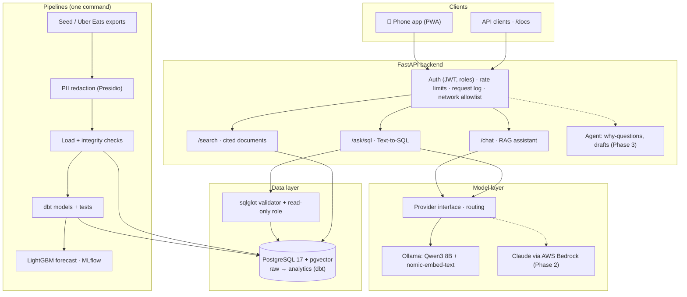
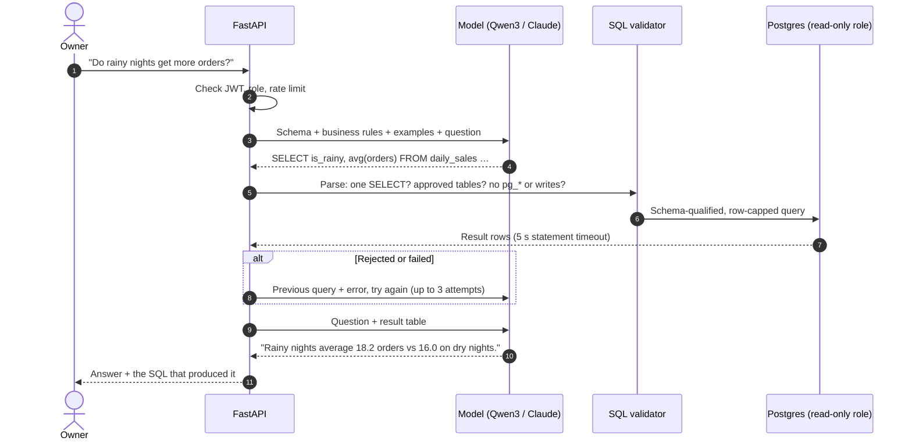
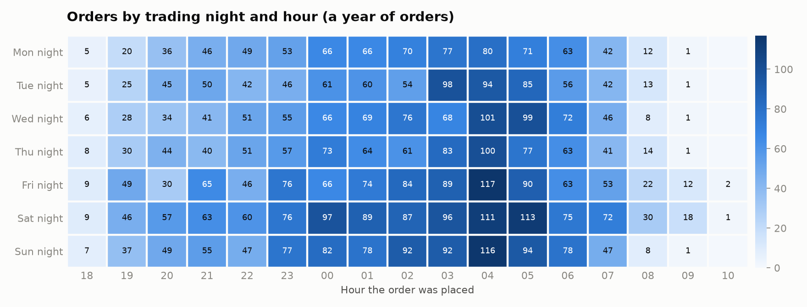
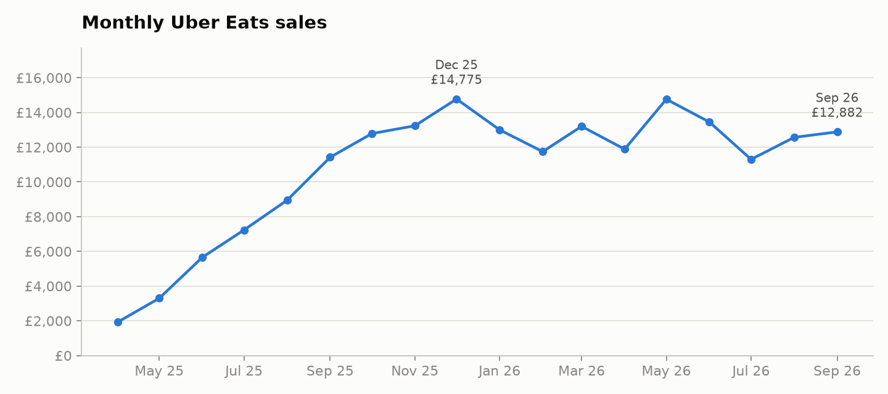

<div align="center">

# Grill House Ops Copilot

**An AI analyst for a real late-night takeaway in Manchester.** It answers questions about sales, deliveries,
menu and reviews in plain English, grounded in the shop's own data, and runs in daily use on the owners' phones.

[](https://github.com/padduchowdary969/grillhouse-ai-assistant/actions/workflows/ci.yml)


[Architecture](docs/ARCHITECTURE.md) · [Design decisions](docs/DESIGN_DECISIONS.md) · [Evaluation](docs/EVALUATION.md) · [Roadmap](docs/ROADMAP.md) · [Project brief](docs/PROJECT_BRIEF.md)

</div>

---

## Why this exists

The shop trades from 18:00 to 08:00 and sells through Uber Eats. Its numbers sit in separate platform exports
that are hard to read mid-shift, and they're grouped by calendar day, which splits every night's trade in two.
This project turns those exports into a copilot the owners can ask things like:

> *"What should I prep for Saturday night?"* · *"Why did orders drop in the week of 10 November?"* ·
> *"Which time slots get the most courier delays?"* · *"Is the chicken halal?"*

The real business data is private and never leaves the owners' Mac. Everything public (this repo, the tests, the
demo) runs on a **synthetic dataset** that copies the shape of a late-night takeaway: about 7,800 orders driven
by real Manchester weather and UK bank holidays.

## Highlights

| | |
|---|---|
| 🗣️ **Grounded answers** | Hybrid retrieval (BM25 + pgvector, reciprocal rank fusion) with source citations; Text-to-SQL over a read-only analytics schema |
| 🛡️ **Safe by construction** | Every model-written query is parsed (sqlglot) and must be a single `SELECT` on approved tables, then runs as a read-only, time-limited database role. PII is redacted at ingestion (Presidio) |
| 📏 **Measured, not assumed** | 93-question golden sets with execution-match scoring; search quality gated in CI |
| 📈 **Forecasting** | LightGBM demand model, rolling-origin backtest against baselines, tracked in MLflow, turned into a buns-and-patties order |
| 📱 **In real use** | Installable phone app (PWA) behind Tailscale with JWT sessions, auto-started on the shop's Mac |
| ⚙️ **Reproducible** | `docker compose up setup` builds the database from empty in about 14 seconds; CI on every push |

## Results

| What | Score |
|---|---|
| Document search, hybrid (20 questions) | **hit@1 1.00**, MRR 1.00 (keyword-only: hit@1 0.90) |
| RAG assistant, hybrid search (23 questions) | **23/23** on real and synthetic data (keyword-only: 16/20) |
| Text-to-SQL, local Qwen3 8B (50 questions, execution match) | 34/50 (68%) |
| Text-to-SQL, Claude via AWS Bedrock | *in progress* |
| Demand forecast, LightGBM vs best baseline (orders/night MAE) | **3.52** vs 3.58 overall · **3.13** vs 3.41 on rainy, event and bank-holiday nights |
| Tests | 81 pytest tests · 16 dbt data tests · all passing in CI |

Details and failure analysis: [docs/EVALUATION.md](docs/EVALUATION.md).

## Architecture



Dashed lines are planned. A full component breakdown, data model and deployment topology are in
[docs/ARCHITECTURE.md](docs/ARCHITECTURE.md).

### How a question is answered



## Tech stack

| Layer | Tools |
|---|---|
| Language and data | Python 3.12, pandas, NumPy |
| Storage and transformation | PostgreSQL 17, pgvector (HNSW), dbt-core 1.12 + dbt-postgres |
| Retrieval | BM25 (rank-bm25), nomic-embed-text embeddings, reciprocal rank fusion |
| Models | Qwen3 8B on Ollama (local); Claude via AWS Bedrock (in progress) |
| Text-to-SQL safety | sqlglot (AST validation), Postgres read-only role with statement timeout |
| Privacy | Microsoft Presidio + spaCy, custom UK phone, postcode and address recognisers |
| Forecasting and tracking | LightGBM, scikit-learn, MLflow (SQLite store) |
| Backend and app | FastAPI, Uvicorn, PyJWT, Pydantic; vanilla JS PWA |
| Context data | Open-Meteo (Manchester weather history), gov.uk bank holidays |
| Infrastructure | Docker Compose, GitHub Actions, macOS launchd, Tailscale Serve (HTTPS, private network) |
| Testing | pytest (81), dbt data tests (16), golden-set evaluators |

## Quick start

```bash
git clone https://github.com/padduchowdary969/grillhouse-ai-assistant.git
cd grillhouse-ai-assistant
cp .env.example .env                  # set the passwords
docker compose up setup               # Postgres + pgvector, synthetic data, dbt models + tests, forecast
```

Then run the API and tests locally:

```bash
python3 -m venv .venv && source .venv/bin/activate
pip install -r requirements.txt
docker compose up -d db
python -m pytest                      # 81 tests
uvicorn app.api:app --port 8000       # interactive API docs at http://localhost:8000/docs
```

The assistant and Text-to-SQL endpoints need a model: install [Ollama](https://ollama.com), then
`ollama pull qwen3:8b` and `ollama pull nomic-embed-text`. On macOS, LightGBM needs OpenMP (`brew install libomp`);
the Docker image already includes it.

<details>
<summary><b>Run each pipeline step yourself</b></summary>

```bash
python -m pipelines.fetch_context     # Manchester weather + UK bank holidays (cached in seed_data/context/)
python -m pipelines.run_all           # everything below, in order
python -m pipelines.make_seed_data    # synthetic orders, items, deliveries, reviews, menu and policies
GRILLHOUSE_DATA=seed_data python -m pipelines.clean_ubereats
GRILLHOUSE_DATA=seed_data python -m pipelines.analyse_ubereats
python -m pipelines.load_db           # load with PII redaction and integrity checks
dbt build --project-dir dbt --profiles-dir dbt
python -m pipelines.forecast_demand   # LightGBM vs baselines, MLflow, ingredient plan
```
</details>

<details>
<summary><b>Run the evaluations</b></summary>

```bash
python -m evals.evaluate_search                     # hit@1 / hit@3 / MRR, keyword vs hybrid (no model needed)
python -m evals.evaluate_sql --provider local       # 50-question Text-to-SQL golden set, execution match
python -m evals.evaluate_chatbot                    # 23-question RAG assistant set
```
</details>

## What the data looks like

<p align="center">
  <br>
  <sub>Orders by trading night and hour (synthetic demo data). A "night" runs from 18:00 to closing, so 04:00 on Sunday belongs to Saturday night.</sub>
</p>

<p align="center">
  <br>
  <sub>Monthly sales after launch (synthetic demo data).</sub>
</p>

## API

| Endpoint | Access | What it does |
|---|---|---|
| `POST /auth/token` | public | Sign in; returns a JWT carrying the role (owner or staff) |
| `POST /chat` | signed in, rate-limited | RAG assistant over the reports, streamed (used by the phone app) |
| `POST /ask/sql` | signed in, rate-limited | Text-to-SQL: question → validated query → answer, with the SQL shown |
| `POST /search` | signed in | Menu and policy search with citations |
| `POST /sql` | owners only | Run a validated read-only query directly |
| `GET /health` | public | Database check |

## Security and privacy

- **Two kinds of data:** real business data lives only in the git-ignored `data/` folder and never enters an image (`.dockerignore`), the database or CI. The public repo contains synthetic data only.
- **Database permissions:** the copilot connects as `copilot_readonly`. It can `SELECT` from `analytics` only, can't see `raw`, runs in read-only transactions and is cancelled after 5 seconds.
- **Query validation:** before any query reaches the database, sqlglot rejects stacked statements, writes (including inside CTEs), system catalogs and `pg_*` functions, and caps results at 200 rows.
- **PII redaction:** names, phone numbers, emails, postcodes and street addresses are masked before storage. The synthetic data includes test cases for redaction, and prompt-injection attempts for the planned guardrails.
- **Access control:** HttpOnly session cookies (Secure over HTTPS), JWT roles, a wrong-password lockout, and per-user rate limits. In the shop's private deployment, only the Mac itself and the Tailscale network can connect.

## Repository layout

```
app/          API, RAG assistant, Text-to-SQL, SQL validator, document search, model providers, config
pipelines/    seed-data generator, context fetch, cleaning, PII redaction, DB load, reports, forecasting
dbt/          analytics models and data tests
db/           schema and database roles
evals/        golden sets, evaluators, results
ui/           phone app (PWA) and icons
tests/        pytest suite
seed_data/    synthetic dataset (public)
scripts/      macOS launcher and auto-start installer for the private deployment
docs/         architecture, design decisions, evaluation, roadmap, project brief
```

## Use it with your own Uber Eats data

Download these reports from Uber Eats Manager and save them in `data/` (git-ignored). Then run
`pipelines.clean_ubereats`, `pipelines.analyse_ubereats` and `pipelines.forecast_ubereats` without `GRILLHOUSE_DATA`.

| Uber Eats report | Save as |
|---|---|
| Sales over time (monthly) | `data/ubereats_monthly_2026.csv` |
| Sales leaderboard: items | `data/ubereats_items_2026.csv` |
| Sales by hour | `data/ubereats_sales_by_hour_2026.csv` |
| User conversion funnel | `data/ubereats_funnel_2026.csv` |
| Ratings | `data/ubereats_reviews_2026.csv` |

For the private phone app on a Mac, see [docs/ARCHITECTURE.md § Deployment](docs/ARCHITECTURE.md#deployment).

## Roadmap

| Phase | Status |
|---|---|
| 1. Data foundation: schema, synthetic data, PII redaction, dbt, one-command setup | ✅ Done |
| 2. Q&A and search: Text-to-SQL, hybrid retrieval, FastAPI, LightGBM, CI, golden sets | 🟡 Bedrock and public demo remaining |
| 3. Agent and actions: LangGraph "why" agent, courier analysis, drafts with human approval, review classifier | ⬜ Next |
| 4. Prove and ship: Ragas/DeepEval, guardrails, RBAC, Langfuse tracing, demo video | ⬜ Planned |

Full checklist: [docs/ROADMAP.md](docs/ROADMAP.md).

## License

[MIT](LICENSE). The synthetic dataset and every name in it are invented.
