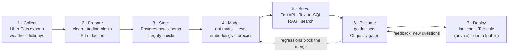
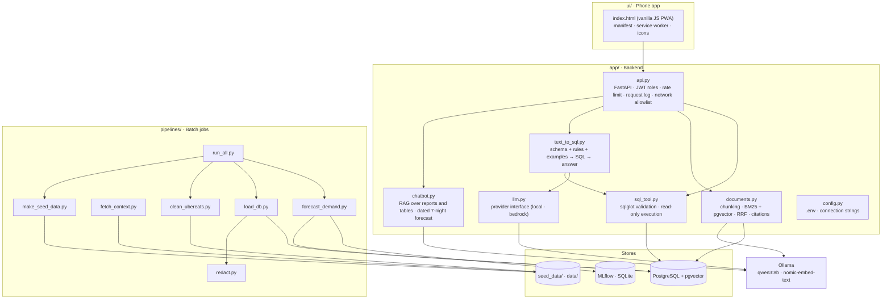
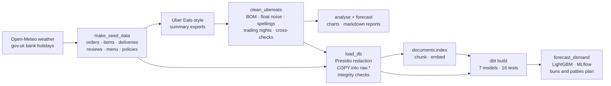
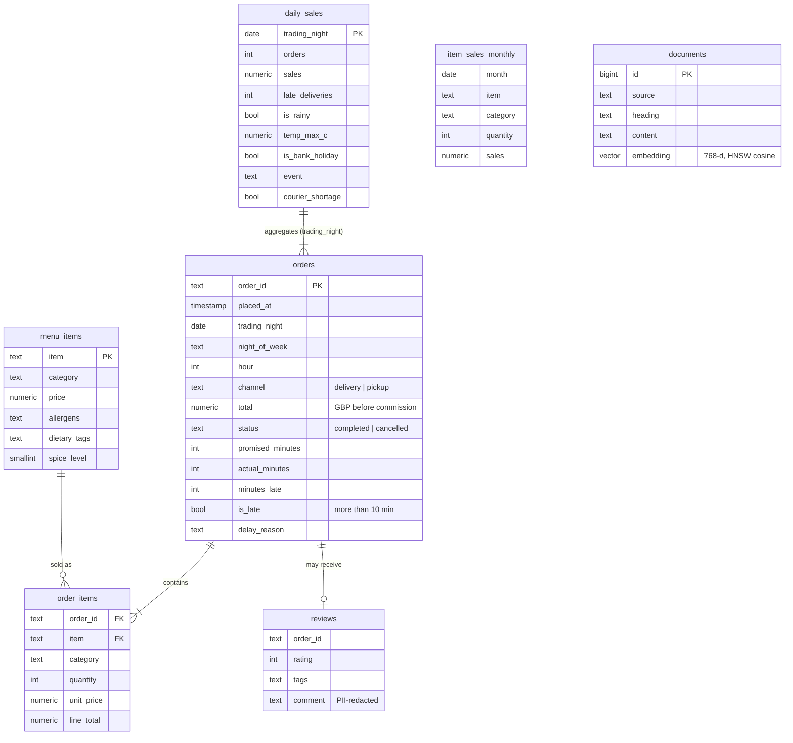
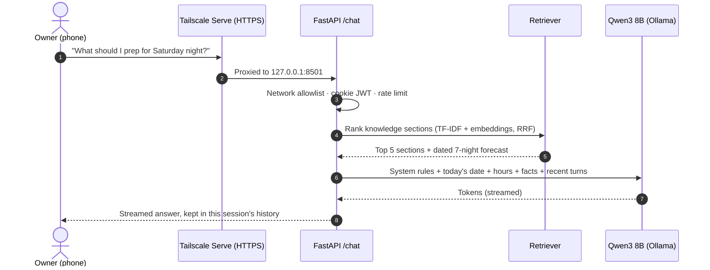
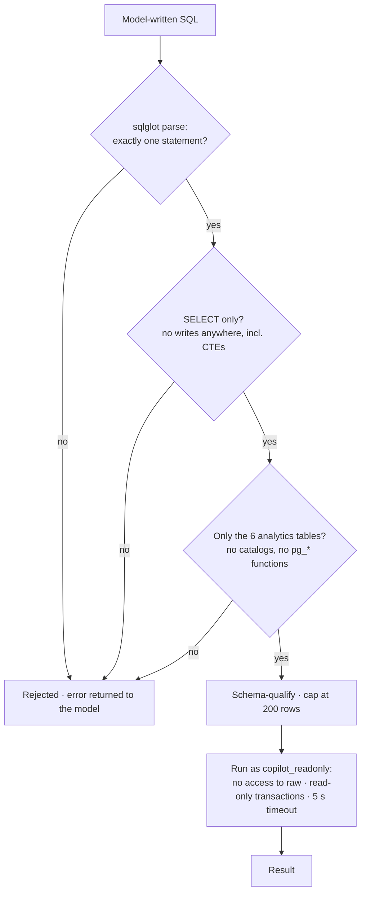
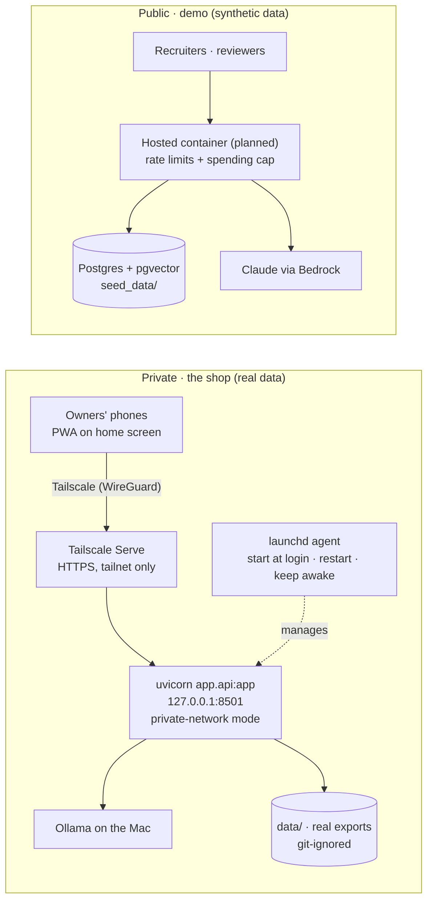
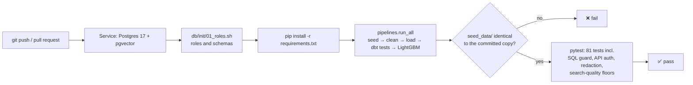

# Architecture

How the Grill House Ops Copilot is built, from raw exports to an answer on a phone.

- [Process map](#process-map)
- [System components](#system-components)
- [Data pipeline](#data-pipeline)
- [Data model](#data-model)
- [Request path](#request-path)
- [Model layer](#model-layer)
- [Security layers](#security-layers)
- [Deployment](#deployment)
- [Continuous integration](#continuous-integration)

## Process map

The end-to-end lifecycle. Each stage has an owner module and a check that has to pass before the next one runs.

| Stage | Modules | Gate |
|---|---|---|
| 1. Collect | `pipelines/fetch_context.py`, `pipelines/make_seed_data.py`, Uber Eats exports in `data/` | Weather and holiday downloads cached; seed generator is deterministic (CI fails on drift) |
| 2. Prepare | `pipelines/clean_ubereats.py`, `pipelines/redact.py` | Totals cross-checked across reports; contact details never stored |
| 3. Store | `pipelines/load_db.py`, `db/schema.sql` | Order totals reconcile with line items; constraints on every table |
| 4. Model | `dbt/`, `app/documents.py`, `pipelines/forecast_demand.py` | 16 dbt data tests; forecaster backtested against baselines |
| 5. Serve | `app/api.py`, `app/text_to_sql.py`, `app/sql_tool.py`, `app/chatbot.py` | Query validation and a read-only role on every query |
| 6. Evaluate | `evals/` | Search-quality floors enforced in CI; model evals scored by execution match |
| 7. Deploy | `scripts/macos/`, `docker-compose.yml`, `.github/workflows/ci.yml` | One-command rebuild; CI on every push |

## System components

| Component | Responsibility | Key design points |
|---|---|---|
| `app/api.py` | HTTP boundary | JWT carries role and session id; cookie sign-in for the PWA, bearer for API clients; sliding-window rate limit; fail-closed network allowlist; JSON request log with latency and model tokens |
| `app/text_to_sql.py` | Question → SQL → answer | Live schema read from `information_schema`; business rules (trading nights, weekends, money before commission); JSON-constrained output; up to 3 attempts with the database error fed back |
| `app/sql_tool.py` | Safe execution | AST checks on top of database permissions; schema-qualifies tables; 200-row cap; errors returned to the model rather than raised |
| `app/documents.py` | Cited search | One chunk per markdown section; HNSW cosine index; BM25 and dense rankings fused with RRF (k = 60); falls back to BM25 if embeddings are missing |
| `app/chatbot.py` | Assistant used by the phone app | Hybrid retrieval over reports and tables; today's date and opening hours pinned in the system prompt; dated next-7-nights forecast built per question |
| `app/llm.py` | Model abstraction | Same `complete()` interface for every provider, returning tokens and latency, so tasks can be routed and compared |
| `pipelines/forecast_demand.py` | Demand forecast | Features only look 7+ nights back, so a full week is forecastable; Poisson objective; rolling-origin backtest; MLflow tracking |

## Data pipeline

`python -m pipelines.run_all` (or `docker compose up setup`) runs every step in order and stops at the first failure.

How the synthetic data is generated:

1. **Demand per night** = plateau × launch ramp and monthly drift × night-of-week weight × rain (+15%) and heat
   (−10%) × bank holiday (+20%) × synthetic events (+25–40%). The order count is Poisson around that.
2. **Each order** gets a time from the shift's hourly profile (peak 03:00–06:00), a basket sampled by item
   popularity, and a channel (2% pickup).
3. **Each delivery** gets a promised time (longer at weekend peaks and in rain) and an actual time with delays from
   rain, peaks and three synthetic courier-shortage weeks. More than 10 minutes over is "late", with a reason.
4. **Ratings** are drawn for 1 in 25 recent orders, and late deliveries are rated worse. A few contain fake
   personal details and prompt-injection attempts, as test cases.
5. **The Uber Eats-style summary exports** are aggregated from those same orders, quirks included, so reports and
   SQL answers agree to the penny.

The patterns are hand-tuned, not fitted to the shop's real data, so nothing private can leak through the generator.

## Data model

`raw` holds tables as loaded. `analytics` holds the dbt models, which are the only tables the copilot can query.

`daily_sales` is built from a calendar, so nights with no orders appear as zeros. That matters for "why did
orders drop?" questions.

## Request path

The Text-to-SQL path is shown in the [README](../README.md#how-a-question-is-answered). The phone app's assistant
works like this:

## Model layer

| Task | Today | Planned |
|---|---|---|
| Assistant answers, Text-to-SQL | Qwen3 8B, 4-bit, local (Ollama), thinking off, temperature 0–0.2 | Claude via AWS Bedrock; route simple, high-volume tasks to a local or fine-tuned model |
| Embeddings | nomic-embed-text (768-d), with task prefixes | same |
| Review classification | keyword themes | TF-IDF + logistic regression baseline vs Llama 3 8B QLoRA (Colab GPU), served through Ollama |
| Forecasting | LightGBM (Poisson objective) | same, with daily real data if available |

Every provider returns tokens and latency, so the routing comparison (accuracy, cost per query, p95 latency)
runs on the same golden sets.

## Security layers

Defence in depth for model-written SQL. Each layer works on its own, so a miss in one is caught by the next.

| Concern | Control |
|---|---|
| Destructive or exfiltrating SQL | sqlglot AST validation + read-only role without access to `raw` |
| Runaway queries | `statement_timeout = 5s` on the role, 200-row cap |
| Personal data | Presidio + UK recognisers at ingestion; dbt test fails if contact details appear |
| Account access | Constant-time password check, lockout after 10 failures, JWT with expiry, HttpOnly + SameSite cookies |
| Network exposure | Server binds to localhost; Tailscale Serve is the only way in; fail-closed allowlist |
| Secrets | `.env` git- and docker-ignored; CI uses throwaway values |
| Prompt injection | Synthetic test cases in reviews today; NeMo Guardrails / Llama Guard in Phase 4 |

## Deployment

Two deployments share one codebase.

**Private deployment (macOS)**

1. Double-click `scripts/macos/start_assistant.command` once to choose the password (saved in `.env`).
2. Double-click `scripts/macos/install_autostart.command`. A launchd agent starts the app at login, restarts it
   if it stops, and keeps the Mac awake on power. `scripts/macos/install_autostart.command remove` undoes it.
3. Run `tailscale serve --bg 8501` once. Devices signed in to the same tailnet open
   `https://<mac-name>.<tailnet>.ts.net` and add it to the home screen.

**Local development:** `docker compose up -d db`, then `uvicorn app.api:app --port 8000`.

## Continuous integration

CI has no model server, so search is gated on its keyword-only scores, and the model-graded evaluations
(Text-to-SQL, assistant) run locally until the Bedrock provider is in place.
