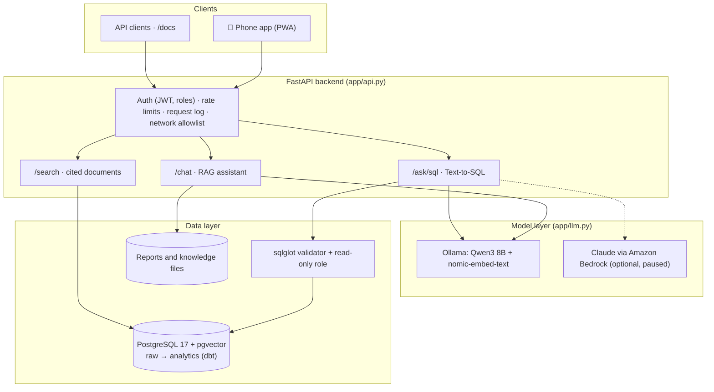

# Grill House AI Assistant: Complete Project Guide

Everything about the project in one document: what it is, how each part works, how to run and maintain it, and
the decisions behind it. For shorter views, see the [README](../README.md) and the
[project brief](PROJECT_BRIEF.md).

**Contents**

1. [Overview](#1-overview)
2. [Timeline](#2-timeline)
3. [Architecture](#3-architecture)
4. [Data](#4-data)
5. [The AI components](#5-the-ai-components)
6. [Forecasting](#6-forecasting)
7. [Evaluation](#7-evaluation)
8. [Deployment](#8-deployment)
9. [Security and privacy](#9-security-and-privacy)
10. [Repository guide](#10-repository-guide)
11. [Command reference](#11-command-reference)
12. [Operating it](#12-operating-it)
13. [Decisions, and what was skipped](#13-decisions-and-what-was-skipped)
14. [Learning labs](#14-learning-labs)

---

## 1. Overview

**The business.** A late-night takeaway in Manchester, open 18:00–08:00 (sometimes 10:00 at weekends), selling
through Uber Eats.

**The problem.** The shop's numbers sit in five separate Uber Eats Manager exports: monthly sales, item
leaderboard, sales by hour, the customer funnel and ratings. They're hard to read on a phone mid-shift. They're
also grouped by calendar day, which splits every night's trade in two: an order at 04:00 on Sunday belongs to
Saturday night's shift.

**What was built.** An AI assistant the owners use on their phones:

| Capability | Example |
|---|---|
| Plain-English answers from the shop's data | "Which night is busiest?" · "What do customers complain about?" |
| Forecasts for planning | "What should I prep for Saturday night?" · "How much will we take this week?" |
| Numbers straight from a database (Text-to-SQL) | "Do rainy nights get more orders?", with the SQL shown |
| Cited menu and policy search | "Is the chicken halal?" → `policies.md › Halal` |
| A demand forecast turned into an order | Next week: ~113 orders → 131 buns, 168 beef patties (synthetic data) |

**Two kinds of data, one codebase.**
- **Real data:** the shop's own exports live in the git-ignored `data/` folder and power the private phone app.
- **Synthetic data:** everything public (the repo, tests, CI, Docker images) runs on a generated dataset for a fictional "Sample Grill Kitchen" that copies the shape of the business.

## 2. Timeline

| Date | Work |
|---|---|
| 19 Oct 2026 | Exported and cleaned the Uber Eats reports; analysis report and charts; first forecast; RAG chatbot on a free local model (Ollama, Qwen3 8B); evaluation set; phone web app with password; Tailscale access; auto-start on the Mac; synthetic sample data; hybrid search |
| 20 Oct 2026 | Adopted the portfolio plan. **Phase 1:** repo restructure, order-level synthetic data with real weather and bank holidays, PostgreSQL + pgvector, PII redaction, dbt models and tests, one-command setup. **Phase 2:** SQL validator, cited document search, Text-to-SQL, FastAPI backend (the phone app moved onto it), LightGBM forecaster with MLflow, CI, 93-question golden sets, professional documentation |
| 21 Oct 2026 | Multi-stage Docker images published to GitHub Container Registry; Bedrock provider built and unit-tested (AWS then paused); one project name; old server removed; learning labs; this guide |

## 3. Architecture



**The process map**, from raw data to a phone:

| Stage | What happens | Gate that must pass |
|---|---|---|
| 1. Collect | Uber Eats exports (real) or the seed generator (synthetic); weather and bank holidays | Generator is deterministic; CI fails if it drifts |
| 2. Prepare | Clean, assign trading nights, redact personal details | Totals cross-checked between reports |
| 3. Store | Load into Postgres `raw` | Order totals reconcile with their items |
| 4. Model | dbt builds `analytics`; documents embedded; forecast trained | 16 dbt data tests; forecaster beats baselines |
| 5. Serve | FastAPI: assistant, Text-to-SQL, search | Query validation and read-only role on every query |
| 6. Evaluate | Golden sets | Search-quality floors in CI |
| 7. Deploy | Private Mac app; Docker images | One-command rebuild; CI on every push |

More diagrams (components, data model, request path, security layers, deployment, CI) are in
[ARCHITECTURE.md](ARCHITECTURE.md).

## 4. Data

### 4.1 The real exports (private, `data/`)

| File | Uber Eats report | What it holds |
|---|---|---|
| `ubereats_monthly_2026.csv` | Sales over time (monthly) | Sales, orders and average order value per month, pickup vs delivery |
| `ubereats_items_2026.csv` | Sales leaderboard: items | Sales and quantity per menu item for the year |
| `ubereats_sales_by_hour_2026.csv` | Sales by hour | Sales and orders by day of week and hour |
| `ubereats_funnel_2026.csv` | User conversion funnel | Store views → menu views → baskets → orders |
| `ubereats_reviews_2026.csv` | Ratings | One row per rating: stars, tags, comment, order times |
| `knowledge/opening_hours.txt` | Written by hand | Opening hours and the trading-night rule |

**All sales figures are what customers paid, before Uber's commission.** The owners think in payouts, so the
assistant is told to say "before commission" when quoting sales.

### 4.2 Cleaning ([`pipelines/clean_ubereats.py`](../pipelines/clean_ubereats.py))

- **Raw-file quirks:** removes the byte-order mark Uber Eats puts at the start of each file, and floating-point noise such as `31704.530000000013`.
- **Names:** normalises column names, and merges duplicate item spellings ("Fanta Orange" / "Fanta orange", "Loaded  beef fries").
- **Misleading columns:** drops the year-on-year % columns, which compared against a year when the shop had barely launched.
- **Trading night:** assigns each hour to the night its shift started, and flags orders outside opening hours.
- **Reviews:** drops Uber's internal IDs, makes tags readable, and computes order-to-delivery minutes.
- **Cross-check:** the monthly, hourly and item exports must agree on the year's totals (within 1% for items).

### 4.3 Synthetic data ([`pipelines/make_seed_data.py`](../pipelines/make_seed_data.py))

The generator is hand-tuned, not fitted to the real data, so nothing private can leak into the public repo.

1. **Context:** real daily Manchester weather (Open-Meteo) and UK bank holidays (gov.uk), fetched by
   [`pipelines/fetch_context.py`](../pipelines/fetch_context.py) and cached in `seed_data/context/`.
2. **Demand per night:**
   ```
   plateau × launch ramp and monthly drift × night-of-week weight
     × rain (+15%) × heat (−10%) × bank holiday (+20%) × events (+25–40%)
   ```
   The order count is Poisson around that.
3. **Each order:** gets a time from the hourly profile (peak 03:00–06:00), a basket by item popularity, and pickup
   or delivery (2% pickup).
4. **Each delivery:** gets a promised time and an actual time, with delays from rain, weekend peaks and three
   synthetic courier-shortage weeks. More than 10 minutes over counts as late, with a reason.
5. **Ratings:** about 1 in 25 recent orders gets one, and late deliveries rate worse. A few contain fake personal
   details and prompt-injection attempts, as test cases.
6. **Summary exports:** the Uber Eats-style files are aggregated from these same orders, quirks included.
7. **Documents:** a menu (prices, allergens, dietary tags, spice levels) and policies (refunds, allergens, halal,
   delivery area, supplier terms).

**Result:** about 7,800 orders, 20,000 basket lines, 7,600 deliveries, 115 ratings. Rainy nights average 16.1
orders vs 12.8 dry, and courier-shortage nights see about 80% of deliveries late vs about 9%.

### 4.4 Database and dbt

- **Two schemas:** `raw` holds data as loaded by [`pipelines/load_db.py`](../pipelines/load_db.py); `analytics` holds the dbt models, the only tables the assistant may query.
- **Two roles:** `grillhouse` owns and loads the data; `copilot_readonly` is what the assistant connects as. It can read `analytics` only, its transactions are read-only, and queries stop after 5 seconds.

| `analytics` table | One row per | Notes |
|---|---|---|
| `orders` | order | promised vs actual minutes, `is_late`, `delay_reason` |
| `order_items` | basket line | category and line total |
| `daily_sales` | trading night | built from a calendar, so zero-order nights appear; weather, bank holiday, event and courier-shortage flags |
| `item_sales_monthly` | item per month | |
| `menu_items` | dish | price, allergens, dietary tags, spice level |
| `reviews` | rating | comment PII-redacted at ingestion |
| `documents` | menu or policy section | 768-dimension embedding, HNSW cosine index |

**dbt tests (16):**
- **Keys:** unique and not-null on every key.
- **Values:** accepted values for channel, status and rating.
- **Relationships:** order items reference real orders.
- **Totals:** nightly totals reconcile with the orders.
- **Privacy:** no phone numbers or emails in reviews.

### 4.5 PII redaction ([`pipelines/redact.py`](../pipelines/redact.py))

- **Engine:** Microsoft Presidio with spaCy's small English model.
- **UK recognisers added:** phone numbers (including Ofcom's 07700 900xxx drama range, which the default check rejects), postcodes and street addresses.
- **Food words excluded:** names such as "Halloumi Burger" and "Crispy" aren't masked as people.
- **Where it runs:** before data reaches the database.
- **Tested:** 0 false alarms on the shop's 45 real comments.

## 5. The AI components

The core idea: **the model only knows what is in its prompt.** Each component decides what goes into that prompt.

### 5.1 The RAG assistant ([`app/chatbot.py`](../app/chatbot.py)): powers the phone app

1. **Knowledge:** reports split by heading, plus tables (items, months, night × hour orders, review comments,
   forecast week) and `knowledge/*.txt`. That makes 13 sections.
2. **Retrieval:** each section is ranked by **TF-IDF keywords** and by **embeddings**
   (`nomic-embed-text`, cosine similarity). The two rankings are merged with **reciprocal rank fusion**, and the
   top 5 are kept.
3. **Prompt:**
   - grounding rules ("use only the facts; otherwise say you don't have that information");
   - today's date and the opening hours, always included;
   - a **dated forecast for the next 7 nights, with its total computed in code**;
   - the retrieved sections;
   - the last few conversation turns.
4. **Answer:** Qwen3 8B (4-bit, local), streamed to the phone.

Lessons that shaped it:
- **"Tonight" was answered with a monthly total.** Fix: a dated 7-night forecast.
- **Weekly totals were added up wrong.** Fix: totals computed in code.
- **"January" didn't match `2026-01`.** Fix: month names added to the tables.
- **The weekend 10:00 close was ignored.** Fix: opening hours moved into the instructions.

### 5.2 Document search ([`app/documents.py`](../app/documents.py))

- **Chunking:** menu and policy markdown is split into one chunk per `##` section.
- **Storage:** chunks are kept in pgvector with an HNSW index.
- **Ranking:** BM25 plus cosine similarity, fused with RRF.
- **Results:** each hit carries a citation such as `policies.md › Allergens`.
- **Fallback:** without embeddings, it uses BM25 alone.

### 5.3 Text-to-SQL ([`app/text_to_sql.py`](../app/text_to_sql.py), [`app/sql_tool.py`](../app/sql_tool.py))

1. **Prompt:** the model gets the live table schema (read from the database), the business rules (trading
   nights, weekends, completed orders only, delay reasons) and three examples.
2. **Writing:** it returns `{"sql": "..."}` in a constrained JSON format.
3. **Validation:** **sqlglot** parses the query and allows exactly one `SELECT` over the six analytics tables. No
   writes anywhere (including inside CTEs), no system catalogs and no `pg_*` functions; results are capped at 200
   rows.
4. **Execution:** it runs as `copilot_readonly`.
5. **Retries:** on rejection or error, the model sees its query and the error, and tries again (up to 3 attempts).
6. **Answer:** a second call turns the result table into one to three sentences; the SQL is returned too.

### 5.4 The model layer ([`app/llm.py`](../app/llm.py))

One `complete()` interface returns text, tokens, latency and an estimated cost, so tasks can be routed and compared.

| Provider | Model | Status |
|---|---|---|
| `local` | Qwen3 8B via Ollama | In use |
| `bedrock` | Claude Opus 5.5 on Amazon Bedrock (Mantle client, client-side refusal fallback to Opus 4.8) | Built and unit-tested against a fake client; live runs paused |

Ollama runs natively on the Mac, because Docker on macOS can't use the Apple GPU. Containers reach it through
`host.docker.internal`.

## 6. Forecasting

| Forecast | File | Method | Output |
|---|---|---|---|
| Monthly (Uber Eats summaries) | [`pipelines/forecast_ubereats.py`](../pipelines/forecast_ubereats.py) | Three simple methods backtested on past months, best one chosen (3-month average on the real data, ~12% error), 80% range | Next 3 months, spread into a typical week by night and hour |
| Nightly demand (synthetic orders) | [`pipelines/forecast_demand.py`](../pipelines/forecast_demand.py) | LightGBM (Poisson), features 7+ nights back so a whole week is forecastable; rolling 8-week backtest vs baselines; MLflow tracking | Next 7 nights + buns and patties to order |

LightGBM backtest, mean absolute error in orders per night (noise floor ≈ 3.26):

| Model | All nights | Rainy, event and bank-holiday nights |
|---|---|---|
| **LightGBM** | **3.52** | **3.13** |
| Same night, 4-week mean | 3.58 | 3.41 |
| Same night last week | 4.57 | 4.18 |

## 7. Evaluation

| Golden set | Size | Result |
|---|---|---|
| Document search (hit@1 / hit@3 / MRR) | 20 | Hybrid 1.00 / 1.00 / 1.00 · keyword 0.90 / 1.00 / 0.95 (gated in CI) |
| RAG assistant (retrieval + expected facts) | 23 | Hybrid 23/23 on real and synthetic data · keyword 16/20 |
| Text-to-SQL (execution match) | 50 | Local Qwen3 8B 34/50 |

The local model's 16 SQL failures break down as:
- **Calendar meaning (3):** for example, Christmas night queried 24 December.
- **Wrong grouping (5).**
- **Missing filters or definitions (5):** for example, cancelled orders counted as orders.
- **Multi-table questions (3).**

Details: [EVALUATION.md](EVALUATION.md).

**Engineering tests:**
- **pytest (84):** SQL guard, read-only role, API auth, roles, rate limit, lockout, network allowlist, redaction, seed-data consistency, forecast leakage, search quality, Bedrock request shape.
- **dbt data tests (16).**
- **A CI drift check** on the synthetic data.

## 8. Deployment

### 8.1 The private shop app (real data)

```
Owners' phones (home-screen web app) ── Tailscale (private network, HTTPS) ──► the shop's Mac
    uvicorn app.api:app on 127.0.0.1:8501 (private-network mode) ◄── launchd: start at login,
    restart if it stops, keep the Mac awake on power          ──► Ollama (Qwen3 8B, embeddings)
```

- **Link:** devices signed in to the same Tailscale account open `https://<mac-name>.<tailnet>.ts.net`.
- **Sign-in:** a password, an HttpOnly session cookie (a 30-day JWT), and a lockout after 10 wrong passwords.
- **Network:** only this Mac and the Tailscale network can connect.
- **Setup scripts:** [`scripts/macos/start_assistant.command`](../scripts/macos/start_assistant.command) (choose a password) and [`scripts/macos/install_autostart.command`](../scripts/macos/install_autostart.command) (auto-start).

### 8.2 Docker images (synthetic demo)

One multi-stage [`Dockerfile`](../Dockerfile), published by CI to GitHub Container Registry for `linux/amd64` and
`linux/arm64`, tagged `latest` and `sha-<commit>`:

| Image | Contents | Size |
|---|---|---|
| `ghcr.io/padduchowdary969/grillhouse-pipeline` | Generator, cleaning, redaction, DB load, dbt, LightGBM, MLflow | ~1.8 GB |
| `ghcr.io/padduchowdary969/grillhouse-api` | FastAPI and phone app, demo reports pre-built | ~0.5 GB |

- **Non-root:** both run as user 10001.
- **Nothing private inside:** no `.env`, no `data/`. The CI smoke test checks this.
- **One command:** `docker compose up` runs `db` (healthy), then `setup` (loads data, dbt tests, forecast, then exits), then `api` on `127.0.0.1:8000`. It takes about 25–30 seconds from empty.

### 8.3 CI ([`.github/workflows/ci.yml`](../.github/workflows/ci.yml))

On every push or pull request:
1. **Set up:** start Postgres + pgvector, create the database roles, install the requirements.
2. **Build the data:** run the whole pipeline (seed, clean, load, dbt tests, LightGBM).
3. **Drift check:** the regenerated synthetic data must match the committed copy.
4. **Test:** run pytest.
5. **Images:** build both, and smoke-test them (imports, non-root, no secrets).

On `main`, CI also pushes the images to GHCR.

## 9. Security and privacy

| Concern | Control |
|---|---|
| Destructive or exfiltrating SQL | sqlglot AST validation + read-only role without access to `raw` |
| Runaway queries | 5-second statement timeout, 200-row cap |
| Personal data | Presidio + UK recognisers at ingestion; dbt test on contact details |
| Account access | Constant-time password check, lockout, expiring JWT, HttpOnly + SameSite cookies (Secure over HTTPS) |
| Network exposure | Server binds to localhost; Tailscale Serve is the only way in; fail-closed allowlist; Docker ports on 127.0.0.1 |
| Secrets | `.env` is git- and docker-ignored; CI uses throwaway values |
| Private data | `data/` never enters git, images, the database or CI |
| Prompt injection | Synthetic test cases in reviews; full guardrails not built (Phase 4 skipped) |

## 10. Repository guide

```
app/            api.py (FastAPI) · chatbot.py (RAG) · text_to_sql.py · sql_tool.py (validator) ·
                documents.py (cited search) · llm.py (providers) · config.py (.env, DB URLs)
pipelines/      make_seed_data · fetch_context · clean_ubereats · redact · load_db · analyse_ubereats ·
                forecast_ubereats · forecast_demand · run_all
dbt/            models/marts/*.sql (7 models) · schema.yml and tests/ (16 tests) · profiles.yml (env-based)
db/             schema.sql (raw tables) · init/01_roles.sh (schemas and roles)
evals/          sql_golden.jsonl · search_golden.jsonl · evaluate_sql / evaluate_search / evaluate_chatbot · results/
labs/           six learning labs + README worksheet
ui/static/      phone app (index.html) and icons
tests/          pytest suite (84)
seed_data/      synthetic dataset: summary exports, orders/, context/, knowledge/
scripts/macos/  launcher and auto-start installer for the private deployment
requirements/   api.txt · pipeline.txt · dev.txt · bedrock.txt (optional)
docs/           architecture · design decisions · evaluation · roadmap · project brief · this guide
data/           the shop's real exports (git-ignored)
```

## 11. Command reference

| Task | Command |
|---|---|
| Whole demo stack (from source) | `docker compose up` |
| Whole demo stack (published images) | `IMAGE_PREFIX=ghcr.io/padduchowdary969/grillhouse IMAGE_TAG=latest docker compose up --no-build` |
| Stop the demo stack | `docker compose down` (add `-v` to wipe its database) |
| Database only | `docker compose up -d db` |
| Build all synthetic data and the database | `python -m pipelines.run_all` |
| Reports only (no database) | `python -m pipelines.run_all --no-db` |
| Refresh weather and holidays | `python -m pipelines.fetch_context` |
| Clean the shop's real exports | `python -m pipelines.clean_ubereats` then `analyse_ubereats` and `forecast_ubereats` |
| Ask the assistant in the terminal | `python -m app.chatbot "Which night is busiest?"` |
| Ask with Text-to-SQL | `python -m app.text_to_sql "Do rainy nights get more orders?"` |
| Run the API locally | `uvicorn app.api:app --port 8000` (docs at `/docs`) |
| Tests | `python -m pytest` |
| Evaluations | `python -m evals.evaluate_search` · `python -m evals.evaluate_sql` · `python -m evals.evaluate_chatbot` |
| Labs | `python -m labs.lab1_what_the_model_sees` … `lab6_evaluation` |
| Restart the shop app after a code change | `launchctl kickstart -k gui/$(id -u)/com.grillhouse.assistant` |

Prefix a command with `GRILLHOUSE_DATA=seed_data` to run it on the synthetic data, or leave the prefix off for the
shop's real data. Commands run from the project root with the virtual environment active
(`source .venv/bin/activate`).

## 12. Operating it

### Monthly refresh (real data)

1. **Download:** in Uber Eats Manager, download the five reports for the latest 12 months.
2. **Save:** put them in `data/` with the same file names (see §4.1). Don't open them in Numbers first.
3. **Rebuild:** run `python -m pipelines.clean_ubereats`, then `python -m pipelines.analyse_ubereats`, then
   `python -m pipelines.forecast_ubereats`.
4. **Restart the shop app:** `launchctl kickstart -k gui/$(id -u)/com.grillhouse.assistant`.

### Troubleshooting

| Symptom | Check |
|---|---|
| Phone app won't load | The Mac is on, awake and online; Tailscale is on on both devices; `launchctl print gui/$(id -u)/com.grillhouse.assistant` shows `running`; log at `~/Library/Logs/grillhouse-assistant.log` |
| "Something went wrong" in answers | The Ollama app is running (llama icon in the menu bar); `curl http://localhost:11434/api/version` |
| "Too many wrong passwords" | Restart the shop app (command above) |
| Answers look out of date | Run the monthly refresh |
| Docker stack won't start | Docker Desktop is running; `.env` has all five values from `.env.example`; `docker compose logs setup` |
| LightGBM step skipped on the Mac | It needs OpenMP: `brew install libomp`. It always runs in Docker and CI |

### Adding a partner's device

1. **Invite:** at login.tailscale.com → **Users → Invite users**.
2. **Install:** they install Tailscale, accept the invite and switch it on.
3. **Open the app:** they open the shop link and sign in with the chat password.

## 13. Decisions, and what was skipped

**Key decisions** (full records in [DESIGN_DECISIONS.md](DESIGN_DECISIONS.md)):
- **Trading night:** every view groups orders by the shift's night, not the calendar day.
- **Synthetic public data:** hand-tuned, so nothing private leaks.
- **Two-layer SQL safety:** query validation plus a read-only role.
- **Hybrid retrieval with RRF:** keywords and meaning combined.
- **Facts computed in code:** totals and dates go into the prompt ready-made.
- **PII redaction at ingestion:** personal details never reach the database.
- **Execution-match scoring:** SQL is judged by its results.
- **Baselines and a noise floor:** the forecaster is compared against simple methods.
- **dbt without Airflow:** a plain runner is enough for one shop.
- **Private deployment on the Mac.**
- **Ollama outside Docker on macOS.**

**Skipped or paused at the owner's request:**

| Item | Status |
|---|---|
| Claude via Amazon Bedrock, model-routing comparison | Provider built and unit-tested; live runs paused (21 Oct 2026) |
| Hosting the shop app on AWS | Declined: the app stays on the Mac for privacy |
| Phase 3: LangGraph agent, courier analysis, drafted emails and actions, fine-tuned review classifier, weekly brief | Skipped (21 Oct 2026) |
| Phase 4: Ragas/DeepEval, NeMo guardrails, RBAC beyond roles, Langfuse tracing, drift monitoring, demo video | Not started |
| Public live demo | Not hosted; anyone can run it with the published images |

**Still open on the owner's side:**
- **Menu with prices:** add it in `data/knowledge/`.
- **Partner's phone:** add it to Tailscale.
- **OpenMP:** install it on the Mac (optional).

## 14. Learning labs

Six scripts in [`labs/`](../labs/) open up the system one idea at a time, on synthetic data with a local model:

| Lab | Idea | What it showed |
|---|---|---|
| 1 | What the model sees | ~2,100 tokens of rules and facts behind a one-line answer |
| 2 | Embeddings | Meaning-matching works without shared words, but can be fooled by one |
| 3 | Retrieval | Keyword vs meaning vs hybrid, and why each misses things |
| 4 | Grounding | Without facts the model invented "150–200 orders"; with facts it said 20, which is correct |
| 5 | Text-to-SQL | The model writes the query, the database supplies the numbers, and dangerous queries are blocked |
| 6 | Evaluation | Business rules in the prompt: 7/8 correct with, 4/8 without |

See the [labs worksheet](../labs/README.md) for questions to check your understanding and a glossary.
